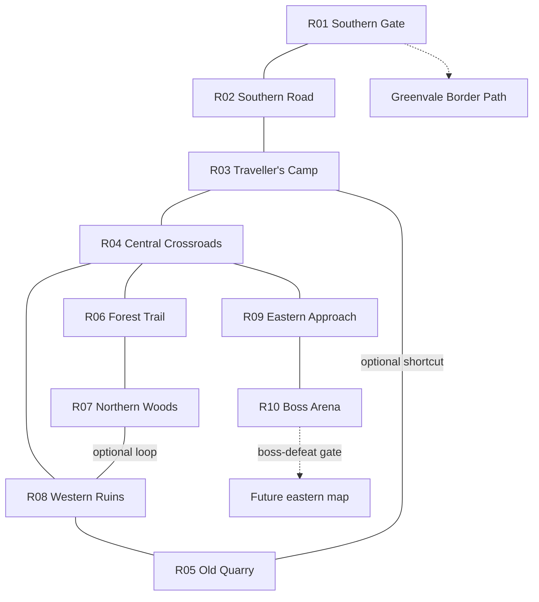

# Greenvale Crossroads — Map Region Graph

**Status:** Proposed topology v0.1. This document is the source of truth for the **proposed** region roster and connections prior to layout approval.

## 1. Graph model

Use an undirected region graph `G = (V, E)` for ordinary internal traversal. Nodes are conceptual gameplay regions, edges are playable connections (road/trail/shortcut), and **gated external transitions** are stored separately from ordinary internal connectivity.

### Nodes

| Node | Region | Primary role |
|---|---|---|
| R01 | Southern Gate | Entry and return transition |
| R02 | Southern Road | Arrival corridor |
| R03 | Traveller's Camp | NPC / commerce / quests / checkpoint |
| R04 | Central Crossroads | Main orientation hub |
| R05 | Old Quarry | Optional stone and ore gathering |
| R06 | Forest Trail | Northern combat trail |
| R07 | Northern Woods | Optional exploration |
| R08 | Western Ruins | Optional challenge / old outpost |
| R09 | Eastern Approach | Boss telegraphing / preparation |
| R10 | Boss Arena | Main encounter and eastern progression gate |

### Internal edges (11)

| Edge | Classification | Notes |
|---|---|---|
| R01–R02 | Main | Southern entry |
| R02–R03 | Main | Approach camp |
| R03–R04 | Main | Camp to central hub |
| R04–R06 | Optional | Northern branch |
| R06–R07 | Optional | Northern exploration |
| R04–R08 | Optional | Western branch |
| R08–R05 | Optional | Quarry spur |
| R04–R09 | Main | Eastern boss route |
| R09–R10 | Main | Boss approach |
| R07–R08 | Optional shortcut | Northern woods to western ruins loop |
| R05–R03 | Optional shortcut | Quarry to camp loop |

### Logical sketch (schematic only)

**This is a connectivity diagram, not literal geographic placement.** The edge table above is authoritative; dashed connections indicate transitions to other maps.

## 2. Main progression spine

`R01 → R02 → R03 → R04 → R09 → R10 → [Eastern exit to next map]`

The player can enter R10 without completing optional NPC quests. The **external eastern transition** is locked until the regional boss is defeated. Details of any arena entrance barrier or encounter lock-in remain TBD.

## 3. Optional loops

- **Northern/western loop:** `R04 → R06 → R07 → R08 → R04`.
- **Western/camp loop:** `R03 → R04 → R08 → R05 → R03`.

Both shortcuts are ordinary traversable connections, not progression gates. They are proposed to reduce backtracking and reward exploration. Their physical shape is not constrained by the drawing.

## 4. External connections

| Region | Destination | Availability |
|---|---|---|
| R01 | Greenvale Border Path | Open |
| R10 | Next major map (name TBD) | Locked until boss defeated |
| R07 | Possible future northern map | Reserved possibility, not an active exit |
| R08 | Possible future western map | Reserved possibility, not an active exit |

## 5. Graph invariants to validate

1. Exactly one identified entry from the previous map (R01).
2. R03 and R04 reachable from R01 without fighting a boss.
3. R10 reachable without a side quest or temporary ally.
4. R05, R06, R07, and R08 remain optional to complete the main route.
5. Two optional loops exist if this topology is approved.
6. External eastern exit remains gated until boss defeat.
7. Graph connectivity must be verified again after conversion to actual traversable terrain; a valid graph alone does not guarantee walkability.

## 6. Design questions

- Should the camp-to-quarry shortcut be open from the beginning or discoverable later?
- Does the northern loop need an environmental landmark or secondary reward?
- Is the boss arena an open field, ruined crossing, or bridge choke point?
- Should roads all meet at one clearly visible junction, or can some branches split slightly beyond R04?

These are **open questions**, not implementation blockers for documenting the graph.
